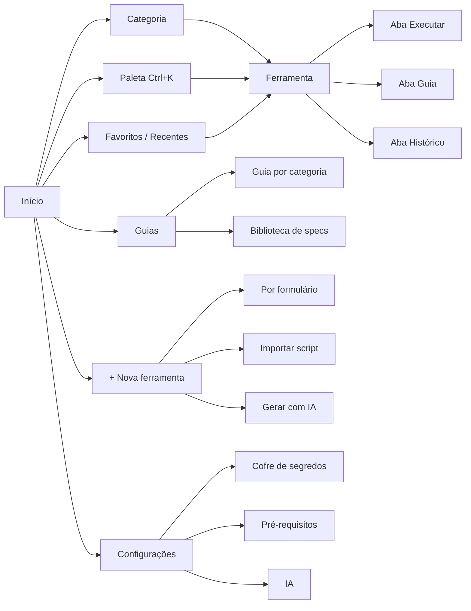

# 02 — Estratégia de produto

30/10/2026 · Xavier (Tangerina Tech)

## 1. Pilares

| Pilar | Pergunta que responde | Entrega |
|-------|-----------------------|---------|
| **Catálogo** | "Que ferramenta eu tenho para isso?" | Navegação por categoria e projeto, busca `Ctrl+K`, favoritos, recentes |
| **Execução** | "Como rodo isso agora?" | Formulário gerado pelo manifesto, log ao vivo, histórico, comando equivalente |
| **Guia** | "Como isso funciona e em que ordem uso?" | Doc por ferramenta, guias por categoria (fluxos), biblioteca de specs |
| **Fábrica** | "Como crio uma ferramenta nova do jeito certo?" | Scaffolder por formulário, importar script existente, gerar com IA |

## 2. Arquitetura de informação

Dois eixos de organização:

- **Categoria** (o que a ferramenta faz). Cada ferramenta tem exatamente uma.
- **Projeto** (para quem ou para qual contexto ela existe). É opcional, funciona como filtro e permite separar ferramentas de cliente das genéricas quando a equipe entrar.

### Categorias iniciais

| Ícone | Categoria | Descrição | Ferramentas (inventário atual + 1ª nova) |
|-------|-----------|-----------|-------------------------------------------|
| 📋 | **Especificação** | Templates e artefatos de especificação de funcionalidades | Template de especificação *(nova)* |
| 🔤 | **Formatação & Conversão** | Transformar texto e documentos | Markdown → Texto, HTML → PDF |
| 🧰 | **DevTools** | Utilitários de desenvolvimento | JWT Decoder |
| 🗄️ | **Banco de Dados** | Banco local, de app ou de ambiente | Pull App DB, Push App DB, Seed DB |
| 🔌 | **API & Massa de Teste** | Gerar, transformar e enviar payloads | Export Audit JSON, Send JSON Files, Sync Items Transform, Generate Request Body |
| 🌿 | **Git** | Repositórios, remotos e relatórios | Git Remote SSH, Git Report |
| 🌐 | **Web & QA** | Captura e inspeção de páginas | Full-page Screenshot |

> Os ícones da tabela são só referência; a interface usa os ícones da biblioteca escolhida no doc 03.

### Projetos iniciais

| Projeto | Ferramentas |
|---------|-------------|
| GDF Boticário (Alpar) | Pull/Push/Seed DB, Export Audit JSON, Send JSON Files, Sync Items Transform, Generate Request Body |
| Genérico (sem projeto) | Todas as demais |

### Mapa de navegação

## 3. Tipos de ferramenta

| Tipo | Implementação | Exemplo |
|------|---------------|---------|
| `ui` | Componente React dentro do portal, sem processo externo | JWT Decoder, Template de especificação |
| `script` | `run.sh` executado em Git Bash, com formulário gerado pelo manifesto | Pull App DB, Git Remote SSH |
| `hybrid` | UI própria que chama um ou mais scripts | Fluxo "Massa de teste" (export → transform → send) |

## 4. Guia: três camadas

| Camada | Fonte | Gerada como |
|--------|-------|-------------|
| **Doc de uso por ferramenta** | `tool.yaml` + `README.md` da ferramenta | Aba "Guia": o que faz, parâmetros, pré-requisitos, exemplos, comando equivalente, riscos |
| **Guia por categoria** | `guides/<categoria>.md` + referências a ferramentas | Página com visão da categoria e fluxos passo a passo (ex.: *Banco do app: pull → inspecionar → push*) com botões que abrem cada ferramenta |
| **Biblioteca de specs** | Pacotes gerados pela ferramenta 01 + specs geradas pela skill | Lista de especificações por projeto, com status (template → spec gerada → em implementação) |

## 5. Fábrica: três modos de criar

| Modo | Fluxo | Resultado |
|------|-------|-----------|
| **Por formulário** | Tipo → nome → categoria → projeto → parâmetros → pré-requisitos | `tools/<id>/` com `tool.yaml`, `run.sh` ou componente base, `README.md` e teste base |
| **Importar** | Escolhe um `.sh` (ou `.html` para reescrever) → portal lê cabeçalho/`--help`/`getopts` → sugere manifesto → usuário revisa | Script copiado para `tools/<id>/` + manifesto + guia |
| **Gerar com IA** | Descreve em texto → escolhe motor (Claude Code CLI ou Claude API) → revisa o *diff* → aprova | Mesmo pacote dos outros modos, gerado a partir da descrição; nada é gravado sem aprovação |

Os três modos convergem para o **mesmo contrato** (manifesto + pasta), validado pelo mesmo esquema.

## 6. Jornadas principais

1. **Rodar uma ferramenta conhecida**: `Ctrl+K` → digita "pull" → Enter → formulário pré-preenchido com a última execução → Executar → log ao vivo → "Abrir pasta de saída".
2. **Preparar uma especificação**: Especificação → Template de especificação → preenche → "Gerar pacote" → pasta aberta + prompt copiado → no Claude, anexa e cola.
3. **Seguir um fluxo**: Guias → Banco de Dados → "Restaurar banco do app" → passo 1 abre Pull App DB… passo 3 Push App DB (com confirmação destrutiva).
4. **Criar ferramenta com IA**: + Nova → Gerar com IA → descreve → revisa arquivos → Salvar → aparece no catálogo com guia.

## 7. Roadmap

| Fase | Entregas | Critério de saída |
|------|----------|-------------------|
| **0 — Fundação** *(agora)* | Documentação, decisões, design inicial | ✅ Perguntas em aberto respondidas (30/10/2026) |
| **1 — MVP** | Repositório, shell Electron + Next, design tokens, layout, catálogo por manifesto, busca `Ctrl+K`, **Ferramenta 01** com guia | Ferramenta 01 usada em uma spec real |
| **2 — Migração** | Runner `.sh` com log/histórico, cofre, tela de pré-requisitos; JWT/Markdown/HTML→PDF em React; porte dos `.ps1`/`.py`/`.js` para `.sh` | 13 ferramentas no catálogo, 0 segredos no código |
| **3 — Fábrica e Guias** | Scaffolder, importar, IA (CLI + API), guias por categoria, biblioteca de specs | 1 ferramenta nova criada por cada modo |
| **4 — Equipe** | Instalador, auto-update, assinatura de código, pacotes por projeto, repositório compartilhado de ferramentas | Outra pessoa da equipe instala e usa |

## 8. Riscos

| Risco | Mitigação |
|-------|-----------|
| Portar PowerShell para Bash quebra fluxos do GDF | Testes com fixtures por script; manter `_tools` intacto até validar |
| `next-electron-rsc` é uma biblioteca de um único mantenedor | Isolar a integração em `electron/next-handler.ts`; plano B = static export + IPC |
| Bash 3.2 no macOS (scripts exigem Bash 4+) | Exigir Bash 4+; o app avisa e mostra como instalar via Homebrew (D20) |
| IA gerar script perigoso | Revisão obrigatória do *diff*, *lint* com `shellcheck`, nada roda sem aprovação |
| Ferramentas de cliente expostas à equipe | Eixo "Projeto" + pacotes separados na fase 4 |
