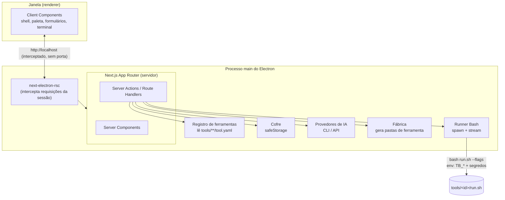
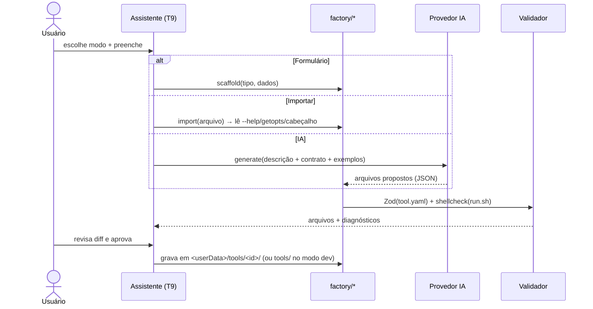

# 04 — Arquitetura técnica

30/10/2026 · Xavier (Tangerina Tech)

## 1. Stack

| Camada | Escolha | Motivo |
|--------|---------|--------|
| Desktop | **Electron** (versão estável atual) | Requisito; acesso a SO, cofre e processos |
| UI + servidor | **Next.js (App Router) via `next-electron-rsc`** | Decisão D11: Server Components e Server Actions acessam Node/Electron direto, sem porta HTTP |
| Linguagem | TypeScript `strict` | — |
| Estilo | Tailwind CSS + shadcn/ui + Lucide | Doc 03 |
| Validação | Zod (manifesto, formulários, saída da IA) | Um esquema para UI, runner e IA |
| Manifesto | YAML (`tool.yaml`) | Legível, padrão Backstage |
| Scripts | **Git Bash (`.sh`)** | Regra do projeto |
| Log ao vivo | xterm.js | Cores ANSI dos scripts |
| Cofre | Electron `safeStorage` (DPAPI no Windows, Keychain no macOS, libsecret no Linux) | Decisão D10 |
| IA | Claude Code CLI **e** Claude API (`@anthropic-ai/sdk`), configurável | Decisão D13 |
| Pacotes | **pnpm** (`node-linker=hoisted` se o electron-builder exigir) | Decisão D23 |
| Empacotamento | electron-builder (`asar: false`, exigência do `next-electron-rsc`) | Fase 4 para distribuição |
| Testes | Vitest (unidade), Playwright for Electron (E2E), testes em Bash puro (padrão do `test-git-remote-ssh.sh`) + shellcheck (scripts) | — |

## 2. Visão geral



Princípios:
- **O renderer não tem Node** (`contextIsolation: true`, `nodeIntegration: false`, `sandbox: true`). Todo acesso a SO passa pelo servidor Next dentro do main.
- **Páginas que leem estado do SO** exportam `dynamic = 'force-dynamic'`.
- **A integração `next-electron-rsc` fica isolada** em `electron/next-handler.ts`. O plano B (static export + IPC) troca só essa camada e as Server Actions viram canais IPC.
- **HTTP externo só pelo servidor** (limitação da biblioteca, e também mais seguro).

## 3. Estrutura do repositório

```
tool-belt/
├─ app/                         # Next.js App Router
│  ├─ layout.tsx                # AppShell
│  ├─ page.tsx                  # T1 Início
│  ├─ c/[category]/page.tsx     # T3 Categoria
│  ├─ t/[toolId]/page.tsx       # T4/T5 Ferramenta (abas)
│  ├─ guides/…                  # T8 Guias e biblioteca de specs
│  ├─ new/…                     # T9 Nova ferramenta
│  └─ settings/…                # T10 Configurações
├─ components/                  # shadcn/ui + componentes do doc 03
├─ lib/
│  ├─ manifest/                 # schema.ts (Zod), loader.ts, registry.ts
│  ├─ runner/                   # bash-locator.ts, run.ts, history.ts
│  ├─ vault/                    # vault.ts (safeStorage)
│  ├─ ai/                       # provider.ts, claude-cli.ts, claude-api.ts, prompts/
│  └─ factory/                  # scaffold.ts, import.ts
├─ electron/
│  ├─ main.ts                   # janela, menu, ciclo de vida
│  ├─ next-handler.ts           # integração next-electron-rsc
│  └─ preload.ts                # mínimo (sem APIs de SO)
├─ tools/                       # ferramentas embutidas (uma pasta por ferramenta)
│  ├─ _lib/common.sh            # funções compartilhadas dos scripts
│  ├─ _templates/               # modelos usados pela Fábrica
│  └─ <id>/                     # tool.yaml, run.sh | ui/, README.md, tests/
├─ guides/                      # guias por categoria (markdown)
├─ scripts/                     # .sh do projeto: dev, build, test, new-tool, validate-tools
├─ docs/                        # esta documentação
├─ next.config.ts
├─ electron-builder.yml
└─ package.json
```

Pastas do usuário (fora do repositório, por SO, via `app.getPath('userData')`):

```
<userData>/
├─ tools/        # ferramentas criadas/importadas pelo usuário (tipo script)
├─ vault.bin     # segredos cifrados pelo safeStorage
├─ history/      # histórico de execuções (JSON por execução + log)
└─ settings.json # tema, caminho do bash, motor de IA, pastas padrão
```

## 4. Manifesto de ferramenta (`tool.yaml`)

```yaml
id: pull-app-db                    # kebab-case, único
name: Pull App DB
version: 1.0.0
type: script                       # ui | script | hybrid
category: banco-de-dados
project: gdf-boticario             # opcional
tags: [android, adb, sqlite]
description: Copia o banco SQLite do app Android (sqflite) para o computador.
entry: run.sh                      # script: arquivo .sh | ui: ui/index.tsx
destructive: false                 # true → modal de confirmação digitada
requires:                          # checados na tela de pré-requisitos
  - { cmd: adb, hint: "Android Platform Tools no PATH" }
inputs:
  - id: pkg
    label: Pacote do app
    type: string                   # string|number|boolean|enum|path|file|dir|list|secret
    default: com.boticario.gdfauditoria
    required: true
    flag: --pkg
  - id: db_path
    label: Caminho do banco no device
    type: string
    default: app_flutter/database/gdf_boticario.db
    flag: --db-path
  - id: out_dir
    label: Pasta de saída
    type: dir
    default: "${TB_OUT_DIR}/android_db"
    flag: --out
secrets: []                        # ex.: [APIGEE_CLIENT_ID_HML]
outputs:
  - { type: file, pattern: "*.db" }
docs: README.md
owner: xavier
```

Regras:
- `loader.ts` valida o manifesto com Zod ao iniciar. Uma ferramenta inválida aparece na lista com um selo de erro, sem derrubar o app.
- Os IDs de categoria vêm de `lib/manifest/categories.ts` (lista fechada; mudar exige decisão).
- Na fase 4, o campo `project` decide em qual pacote a ferramenta é distribuída.

## 5. Runner de scripts

### Localização do Bash

| SO | Ordem de busca |
|----|----------------|
| Windows | `settings.bashPath` → `git --exec-path` (deriva `…\Git\bin\bash.exe`) → `C:\Program Files\Git\bin\bash.exe`. **Nunca** `C:\Windows\System32\bash.exe` (WSL) |
| macOS / Linux | `settings.bashPath` → `/usr/bin/env bash` (exige Bash 4+, D20; no macOS o app orienta a instalar via Homebrew) |

### Execução

1. Monta os argumentos a partir de `inputs[].flag` e dos valores do formulário (`spawn` com array, **sem shell intermediário**, então não há injeção).
2. Monta o ambiente: `TB_TOOL_ID`, `TB_RUN_ID`, `TB_OUT_DIR`, `TB_OS` e os segredos declarados em `secrets` (só os declarados).
3. `spawn(bash, [entry, ...args], { cwd: toolDir, env })`.
4. Faz streaming de stdout/stderr para o `RunTerminal`, mascarando os valores de segredo (`****`) no log.
5. Grava o histórico: parâmetros (sem segredos), duração, código de saída, caminho do log e saídas.
6. O botão Cancelar envia `SIGTERM` e, depois de 5 s, `SIGKILL` (no Windows, `taskkill /T`).

> **Spike obrigatório na fase 1:** confirmar se o streaming (Route Handler com `ReadableStream`/SSE) atravessa o interceptor do `next-electron-rsc` sem bufferizar. Se bufferizar, o log vai por um canal IPC dedicado (`preload` expõe apenas `onRunLog(runId)`).

### Convenções do `run.sh`

```bash
#!/usr/bin/env bash
set -Eeuo pipefail
source "$(dirname "$0")/../_lib/common.sh"   # log, step, die, require_cmd, to_native_path

usage() { cat <<'EOF'
Uso: run.sh --pkg <pacote> [--db-path <caminho>] [--out <pasta>]
EOF
}
```

| Convenção | Regra |
|-----------|-------|
| Parâmetros | Flags longas (`--nome valor`); `--help` obrigatório |
| Segredos | Só por variável de ambiente, nunca por flag |
| Progresso | Linha `::step:: 2/4 Verificando banco…` (vira barra de progresso) |
| Saídas | Linha `::output:: <caminho>` (vira item clicável no `OutputPanel`) |
| Códigos de saída | `0` OK · `1` erro de execução · `2` uso incorreto · `3` pré-requisito ausente · `4` cancelado pelo usuário |
| Caminhos | Recebe caminhos nativos; `common.sh` converte com `cygpath` quando estiver no Windows |
| Interação | Proibido `read` interativo; confirmações ficam no manifesto (`destructive`) |
| Qualidade | Passa no `shellcheck`; testes em `tests/test-*.sh` (Bash puro, HOME isolado, sem rede) |

## 6. Cofre de segredos

- `vault.ts` cifra/decifra com `safeStorage.encryptString` e guarda tudo em `<userData>/vault.bin`.
- **Chaves nomeadas** em CAIXA_ALTA (ex.: `APIGEE_CLIENT_ID_HML`, `ANTHROPIC_API_KEY`, `GDF_USER_EMAIL`).
- A tela Configurações → Cofre lista as chaves, quais ferramentas usam cada uma e o status (definida/ausente). O valor nunca é exibido depois de salvo; só pode ser substituído.
- A ferramenta recebe apenas os segredos declarados no seu `tool.yaml`.
- Se `safeStorage.isEncryptionAvailable()` for falso (Linux sem libsecret), o app avisa e não grava.

## 7. Fábrica de ferramentas



- **IA, provedor CLI:** `claude -p "<prompt>" --output-format json`, com o prompt pedindo um JSON `{ files: [{ path, content }] }`. Usa a assinatura do Claude Code, sem chave.
- **IA, provedor API:** `@anthropic-ai/sdk`, com a chave `ANTHROPIC_API_KEY` no cofre e o modelo configurável.
- O prompt carrega o contrato: esquema do manifesto, convenções do `run.sh`, `common.sh` e uma ferramenta de exemplo.
- **Ferramentas `ui` geradas em tempo de execução** não entram no bundle do Next já compilado. No uso pessoal (rodando do repositório), elas são gravadas em `tools/` e aparecem depois de recarregar o ambiente de desenvolvimento. Na fase 4, as ferramentas `ui` do usuário rodam em uma `webview` isolada. Ferramentas `script` funcionam na hora.

## 8. Scripts do projeto (`scripts/*.sh`)

| Script | Faz |
|--------|-----|
| `dev.sh` | Instala dependências se preciso e sobe Next + Electron em modo dev |
| `build.sh` | `next build` (standalone) + electron-builder |
| `test.sh` | Vitest + testes Bash das ferramentas + shellcheck |
| `new-tool.sh` | Scaffolder em linha de comando (mesmo template da Fábrica) |
| `validate-tools.sh` | Valida todos os `tool.yaml` e roda shellcheck em `tools/**/run.sh` |

## 9. Segurança

- `contextIsolation`, `sandbox` e CSP restrita no renderer.
- `spawn` sem shell; parâmetros validados pelo tipo declarado.
- Segredos só em memória durante a execução, mascarados no log e fora do histórico.
- Ferramentas `destructive: true` exigem confirmação digitada.
- Código gerado por IA nunca é executado antes da aprovação do usuário.
- `_tools` original permanece intacto até a migração ser validada.
